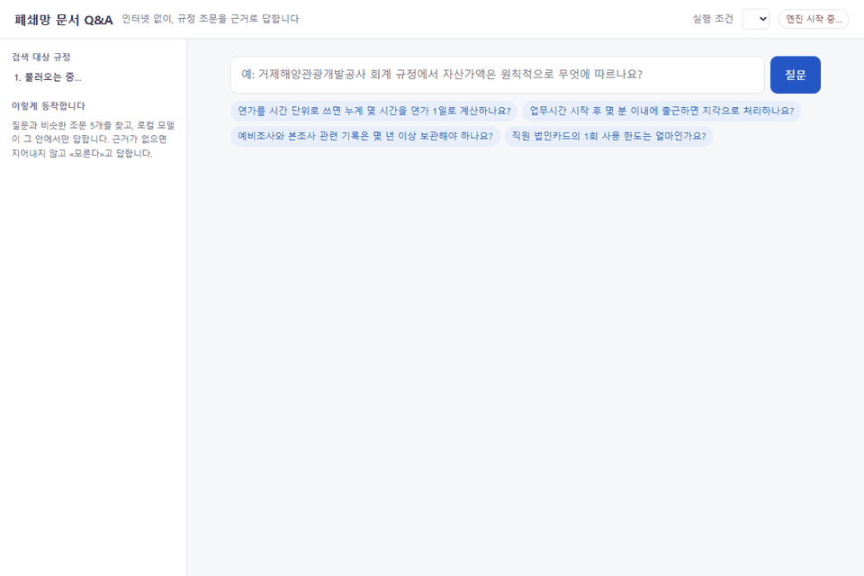

# 폐쇄망 문서 Q&A (local-docqa)

인터넷도 GPU도 없는 사무실 PC에서, 규정 문서(HWPX)를 넣으면 **근거 조항을 인용해 답하고, 근거가 없으면 «모른다»고 답하는** 로컬 AI입니다.



**한 줄 결과** — 공개 규정 8개·100문항에서, GPU를 끈 PC의 4B 모델이 **정확도 87.1%**(GPU 9B 모델 89.4%), **근거 없는 질문 15개 모두 «모른다»**, 평균 **6.9초**로 답했습니다. GPU가 없으면 잃는 것은 정확도가 아니라 속도였습니다.

## 1. 문제

- 공공기관·방산 같은 곳의 업무 PC는 **폐쇄망**이라 ChatGPT 같은 클라우드 AI를 쓸 수 없고, 대개 **GPU도 없습니다**.
- 그래서 문서 업무 자동화는 규칙(정규식·사전) 기반으로 해 왔습니다. 규칙은 정확하지만, «연가는 며칠까지 쓸 수 있지?» 같은 자연어 질문에는 답하지 못합니다.
- 질문: **GPU 없는 PC에서 도는 작은 로컬 LLM으로도 쓸 만한 문서 Q&A가 되는가?** 된다면 GPU가 있을 때와 비교해 무엇을 잃는가?
  느낌이 아니라 **숫자로** 비교합니다.

## 2. 방법

```
HWPX ──읽기──▶ 문단 ──조 단위로 나누기──▶ 조문 534개 ──임베딩(bge-m3)──▶ SQLite
                                                                         │
질문 ──임베딩──▶ 벡터 검색 + 글자 검색(FTS5) ──RRF로 합치기──▶ 상위 5개 조문 ─┘
                                                     │
                                  로컬 LLM(Ollama) ◀─┘  «이 조문 안에서만 답하라»
                                         │
                       JSON {answerable, answer, citations} ──▶ 답 + 근거 조문 / «모른다»
```

| 단계 | 선택 | 이유 |
|---|---|---|
| 문서 읽기 | `zipfile` + `xml.etree` (표준 라이브러리) | HWPX는 zip 안의 XML. 폐쇄망에 설치할 것을 줄인다 |
| 나누는 단위 | **조(條)** 하나 = 덩어리 하나, 1,500자 넘으면 항 경계에서 나눔 | 규정 질문의 근거는 «제○조»로 말한다 → 정답 근거와 바로 비교 가능. 항만 떼면 주어·조건이 끊긴다 |
| 임베딩 | `bge-m3` (Ollama) | 다국어(한국어 포함) 검색에 강하고 CPU에서도 돈다 |
| 저장·검색 | **SQLite 한 파일** (벡터는 BLOB, 코사인은 numpy) + FTS5 trigram | 벡터 DB 서버가 필요 없다. 조문 수천 개면 전수 계산도 수 ms |
| 검색 합치기 | 벡터 순위 + 글자 순위를 **RRF**(1/(60+순위) 합) | 뜻 검색은 «쉬는 것↔휴직»에 강하고, 글자 검색은 «60일», 기관명 같은 정확한 낱말에 강하다 |
| 답변 | Ollama, `temperature 0`, **JSON 틀(schema) 강제** | 답할 수 있는지·인용 번호를 기계가 검사할 수 있게 |
| 환각 막기 | 보여 준 조문 번호가 아닌 인용은 버림. 답한다면서 인용이 없으면 «모른다»로 바꿈 | 근거를 지어내지 못하게 |

### 자료

[국가법령정보센터](https://www.law.go.kr)에 공개된 공공기관 규정 8개(최신판 HWPX)입니다. `data/raw/`

| 번호 | 규정 | 조문 덩어리 |
|---|---|---|
| 01 | (건강보험심사평가원) 인사규정 | 81 |
| 02 | (건강보험심사평가원) 상임임원 복무 등에 관한 규정 | 21 |
| 03 | (거제해양관광개발공사) 보수 규정 | 52 |
| 04 | (건강보험심사평가원) 직제규정 | 21 |
| 05 | (거제해양관광개발공사) 회계 규정 | 239 |
| 06 | (여수시도시관리공단) 환경미화원 취업규칙 | 77 |
| 07 | (여수시도시관리공단) 위임전결규정 | 10 |
| 08 | (한국교육과정평가원) 연구윤리확보를위한규칙 | 33 |

기관이 다른데 주제가 겹치는 규정(인사규정·취업규칙·상임임원 복무규정에 모두 «연가»가 있음)을 일부러 섞었습니다. 어느 기관 규정인지 가려내는 것도 시험 대상입니다.

### 평가 세트 (100문항) — 만드는 방법

`evaluation/qa_set.jsonl` · 만드는 코드 `evaluation/build_set.py`

1. **조문 뽑기**: 문서마다 조문 수에 비례해 할당(최소 5개, 합 85)하고, `seed=7`로 무작위로 뽑았습니다. 짧은 조문(80자 미만), «삭제»된 조문, «목적» 조문은 뺐습니다. → `evaluation/sampled_articles.md`
2. **질문 초안**: 뽑힌 조문 하나만 읽으면 답할 수 있는 질문·짧은 정답·**정답 핵심어**를 씁니다. 질문 앞에는 «○○기관 ○○규정에서»를 붙입니다(사용자는 보통 어느 규정인지 말하고 묻기 때문).
   - 처음에는 로컬 LLM으로 자동 생성을 시도했습니다(`evaluation/make_set.py`). qwen2.5:7b는 중국어가 섞이고 핵심어를 원문에 없는 말로 지어냈고, qwen3-vl:8b는 생각 모드가 꺼지지 않아 문항당 1분 넘게 걸렸으며, mistral-small(24B)은 정답 계산(재직 5년 연가 일수)을 틀렸습니다.
   - 그래서 초안은 **Claude(개발을 도운 AI 코딩 도구)가 공개 조문을 읽고 작성**했습니다. 평가 대상 모델과 다른 모델이 만들었으므로 «자기가 낸 문제를 자기가 푸는» 편향은 없습니다.
3. **기계 검사** (`build_set.py check`, 하나라도 걸리면 세트를 만들지 않음):
   - 정답 핵심어가 근거 조문 원문에 **글자 그대로** 있는가 (띄어쓰기 무시)
   - 핵심어가 질문에 이미 들어 있지 않은가 (질문만 보고 맞히는 문제 방지)
   - 질문에 조 번호가 없고, 기관 이름이 있는가
4. **근거 없는 질문 15개** (`evaluation/unanswerable.jsonl`): 규정에 있을 법하지만 실제로는 없는 내용(학자금, 법인카드 한도, 생성형 AI 출처 표기 등)을 손으로 썼습니다. 각 질문의 열쇠말(`check_terms`)이 그 문서 원문에 **한 번도 나오지 않는지** 기계로 확인합니다.
5. **검토**:
   - 초안 단계에서 85문항 전부를 근거 조문과 대조했고, 답이 둘로 읽히는 문항(예: 입증 책임이 제13조는 «연구윤리위원회», 제19조는 «조사위원회»)은 뺐습니다.
   - **자동 검증** (`evaluation/verify_set.py` → `verify_report.json`). 처음에는 사람이 20문항에 O/X를 매기려 했지만, 법 지식이 있어야 해서 기계로 확인할 수 있는 것은 기계로 바꿨습니다.
     - 답 있는 85문항: 핵심어가 들어 있는 **문단(항)**을 찾아, 질문과 같은 이야기인지 글자쌍 겹침률로 봅니다. 겹침률이 0.35보다 낮은 11개와, 네 조건 모두 틀린 8개(겹치는 것 빼고 16개)를 원문과 다시 대조했습니다. 16개 모두 정답과 근거가 맞았습니다. 겹침률이 낮은 이유는 대부분 «1. 이사장의 결재사항 / 라. 주요사업의 합법성 검토»처럼 정답이 목록 항목에 있고 질문 낱말은 위 제목 줄에 있는 꼴이었습니다. 네 조건 모두 틀린 문항은 문제 탓이 아니라 검색이 조문을 못 찾았거나(조문이 둘로 나뉜 경우 포함), 모델이 원문과 다른 말로 답한 경우(예: 취득가액 → 취득원가)였습니다.
     - 근거 없는 15문항: 열쇠말을 그 문서뿐 아니라 **8개 문서 전체**에서 찾았습니다. 13개는 어디에도 없고, 2개는 낱말 일부(«차량», «카드»)가 다른 뜻으로만 나옵니다(«차량운반구», «인사기록카드»). 질문이 묻는 내용(관용차량 배정, 법인카드 한도)은 어느 문서에도 없습니다.
   - **사람 확인(글자 맞추기)**: `evaluation/review_sample.md`. 목록 항목에 정답이 있는 5문항을 골라, 법 지식 없이 «질문 글자와 정답 글자가 원문에서 이어지는가»만 봅니다. → 결과: 아직 하지 않았습니다(현재는 자동 검증만 함).

### 채점 (모두 기계 채점)

| 지표 | 정의 |
|---|---|
| 정확도 | 답이 있는 85문항 중, 모델이 답했고 **정답 핵심어가 모두** 답에 들어 있는 비율 |
| 근거 일치율 | 답이 있는 85문항 중, 모델이 인용한 조문에 정답 조문이 들어 있는 비율 |
| «모른다» 정답률 | 근거 없는 15문항 중, «모른다»고 답한 비율 |
| 잘못된 거절 | 답이 있는 문항인데 «모른다»고 한 비율 |
| 검색 재현율@5 | 정답 조문이 검색 상위 5개 안에 든 비율 (틀린 원인이 검색인지 LLM인지 가르기 위해) |
| 응답 시간 | 질문 1개당 검색 + 답변 생성 시간 |
| 최대 메모리 | Ollama 프로세스 + 파이썬 프로세스 RAM 합의 최댓값(0.2초 간격), GPU 메모리 최댓값 |

## 3. 결과

측정일 2026-11-17 · Ollama 0.40.16 · 임베딩 bge-m3 · 100문항(답 있음 85 + 근거 없음 15) · `temperature 0` · 원자료 `evaluation/runs/`

| 조건 | 모델 | 정확도 | 근거 일치율 | «모른다» 정답률 | 잘못된 거절 | 응답 시간 평균 (95%) | 최대 RAM | GPU 메모리 |
|---|---|---|---|---|---|---|---|---|
| GPU | qwen3.5:9b | **89.4%** | 81.2% | 100% (15/15) | 9.4% | **0.8초** (1.1초) | 10.1GB | 7.3GB |
| GPU (구세대 비교) | qwen2.5:7b | 87.1% | 72.9% | 100% | 9.4% | 0.6초 (1.0초) | 8.4GB | 5.6GB |
| **사내 PC** (GPU 끔) | qwen3.5:4b | **87.1%** | **88.2%** | **100%** | 8.2% | **6.9초** (12.4초) | 12.6GB | 0 |
| 사내 PC, 4스레드 | qwen3.5:4b | 87.1% | 88.2% | 100% | 8.2% | 8.9초 (15.8초) | 12.6GB | 0 |

- 검색 재현율@5는 네 조건 모두 **92.9%**(같은 검색기를 쓰므로 같음).
- GPU 메모리는 측정 중 최댓값에서 측정 전 바탕값(화면 등, 약 4.4GB)을 뺀 값.
- 모델을 처음 올리는 시간(데우기)은 응답 시간에서 뺐다: GPU 5~6초, CPU 약 10초.

### 결과 읽기

1. **GPU 없이도 정확도는 거의 같다.** 9B·GPU 89.4% → 4B·CPU 87.1%, 85문항 중 2문항 차이. 잃는 것은 속도(0.8초 → 7~9초)다.
2. **«모른다»는 모든 조건에서 15/15.** 근거 없는 질문에 지어낸 답을 한 번도 하지 않았다. 검색이 정답 조문을 못 찾은 6문항에서도 지어내지 않고 «모른다»고 했다(그래서 «잘못된 거절»에 잡힘).
3. **근거 일치율은 4B가 오히려 가장 높다(88.2%).** «답은 맞혔는데 인용이 틀린» 경우가 4B 3건, 9B 7건, 7B 14건이었다(«제1조(목적)»처럼 엉뚱한 조문을 대는 식). 모델이 크다고 인용까지 정확한 것은 아니다.
4. **같은 세대끼리 비교해야 한다.** 구세대 7B(qwen2.5)는 신세대 4B보다 근거 일치율이 15%p 낮다.
5. **메모리**: CPU 조건 12.6GB 중 모델 자체는 약 5GB(4B 모델 약 3.8GB + 임베딩 1.3GB)다. 나머지는 Ollama 엔진(llama-server)의 **프롬프트 캐시**가 앞선 질문을 RAM에 최대 8GB까지 쌓아 둔 것(서버 기록 «prompt cache is enabled, size limit: 8192 MiB»). 질문이 쌓일수록 늘어나며, 그래도 16GB 안에 든다.
6. **4스레드로 묶으면** 평균 6.9초 → 8.9초(약 1.3배). 이 PC의 CPU(8코어 16스레드)는 사무용 PC보다 빠르므로, 실제 사내 PC에서는 10초 안팎을 예상한다(추정, 미측정).

### 틀린 문항 분석 (사내 PC 조건, 답 있는 85문항 중 정확도·근거에서 걸린 14건)

| 원인 | 건수 | 예 |
|---|---|---|
| 검색이 정답 조문을 못 찾음 → «모른다» | 6 | «위원장은 누가?» — 질문 낱말과 조문 낱말이 달라 상위 5개에 못 듦 |
| 답은 맞고 인용이 틀림 | 3 | 답 «100일»은 맞는데 근거로 다른 문서의 제1조를 댐 |
| 답 내용이 틀림 | 3 | 6급나 근속승진을 «5년»으로 답함(정답 3년, 5년은 5급) |
| 채점이 엄격해서 틀림 처리 | 1 | «지역별 분사무소»(=본부)라고 맞게 답했으나 핵심어 «본부»가 없음 |
| 답할 수 있는데 거절 | 1 | 난임치료시술휴가(조문이 길어 둘로 나뉜 뒷부분에 답이 있음) |

### 한계

- 문항 100개, 문서 8개로 작은 실험이다. 1~2문항 차이는 우연일 수 있다.
- 핵심어 채점은 같은 뜻의 다른 표현을 틀림으로 본다(위 1건). 사람 채점이나 LLM 채점을 더하면 보완된다.
- 질문 초안은 AI가 썼고, 검증도 기계 검사와 AI 대조로만 했다. 법 지식이 있는 사람이 검토한 것은 아니다.
- 사내 PC는 GPU를 끈 이 PC로 흉내 낸 것이다. 실제 사무용 PC에서는 재지 않았다.

## 4. 실행 방법

준비: [uv](https://docs.astral.sh/uv/), [Ollama](https://ollama.com) 0.40 이상 (0.21에서는 qwen3.5를 받을 수 없었고, bge-m3가 일부 질문에서 NaN을 내는 문제가 있었음)

```bash
ollama pull bge-m3
ollama pull qwen3.5:4b      # 사내 PC 조건(GPU 없음)
ollama pull qwen3.5:9b      # GPU 조건
uv sync
uv run docqa ingest                                   # data/raw/*.hwpx → data/index.sqlite
uv run docqa ask "건강보험심사평가원 인사규정에서 입양휴가는 며칠인가요?"
uv run docqa ask "..." --profile cpu                  # GPU 끄고 4B 모델로
uv run python -m evaluation.build_set check           # 평가 세트 검사·생성
uv run python -m evaluation.run_eval --profile gpu    # 측정 → evaluation/runs/
uv run python -m evaluation.run_eval --profile cpu
```

자료와 모델을 받아 둔 뒤에는 인터넷이 필요 없습니다. Ollama는 `127.0.0.1`(이 PC 안)으로만 호출합니다.

### 화면 (데스크톱 앱)

```
Tauri 창 (ui/index.html) ──HTTP 127.0.0.1:8765──▶ 파이썬 엔진 (docqa serve) ──▶ Ollama
```

- 창은 [Tauri 2](https://tauri.app)로 만들었습니다. 창을 열면 파이썬 엔진을 뒤에서 띄우고, 닫으면 끕니다(`app/src-tauri/src/main.rs`).
- 화면은 HTML 한 파일이라 브라우저로도 똑같이 쓸 수 있습니다: `uv run docqa serve` 후 `http://127.0.0.1:8765`.
- 답 아래에 근거 조문 원문을 펼쳐 보이고, 답에 나온 숫자·낱말을 원문에서 칠합니다. 실행 조건(GPU 9B / CPU만 4B)을 고를 수 있습니다.
- 엔진 API는 파이썬 표준 라이브러리(`http.server`)만 써서, 폐쇄망에 따로 설치할 것이 없습니다.

```bash
uv run docqa serve                         # 브라우저로 쓰기
cd app && npm install && npm run build     # 데스크톱 앱 빌드 → app/src-tauri/target/release/docqa-app.exe
uv run python scripts/record_demo.py       # 데모 GIF 녹화 → docs/demo.gif
```

앱 빌드에는 Rust와 Node.js가 필요합니다. 만든 exe는 이 프로젝트 폴더 안(또는 `DOCQA_ROOT` 환경 변수가 가리키는 곳)의 `.venv`로 엔진을 띄웁니다.

## 폴더 구조

```
docqa/        엔진: hwpx.py(읽기) structure.py(조 나누기) store.py(SQLite 검색) engine.py(답변) server.py(화면용 API) cli.py
ui/           화면: index.html (앱과 브라우저가 같이 씀)
app/          데스크톱 앱(Tauri): src-tauri/src/main.rs
evaluation/   평가: build_set.py(세트 만들기·검사) verify_set.py(자동 검증) review_sheet.py(사람 확인 시트) run_eval.py(측정) qa_set.jsonl runs/(결과)
scripts/      record_demo.py(데모 GIF 녹화)
data/raw/     공개 규정 HWPX
```

## 앞으로 해 볼 것

- 검색 개선: 틀린 14건 중 6건이 검색 실패다. 재순위 모델(reranker)을 붙이거나 긴 조문을 나눌 때 조 제목을 조각마다 붙인다. 평가 세트에 맞춰 고치지 않도록, 새 문항으로 따로 잰다.
- 화면에서 HWPX를 끌어다 놓아 바로 색인에 넣기.
- 실제 사무용 PC(GPU 없음, RAM 16GB)에서 다시 재기. Ollama 프롬프트 캐시 크기를 줄였을 때의 메모리.
- 핵심어 채점을 보완할 사람 채점 또는 LLM 채점.

## 라이선스

코드는 MIT. `data/raw/`의 규정 원문은 각 기관이 공개한 자료로, [국가법령정보센터](https://www.law.go.kr)에서 받았습니다.
